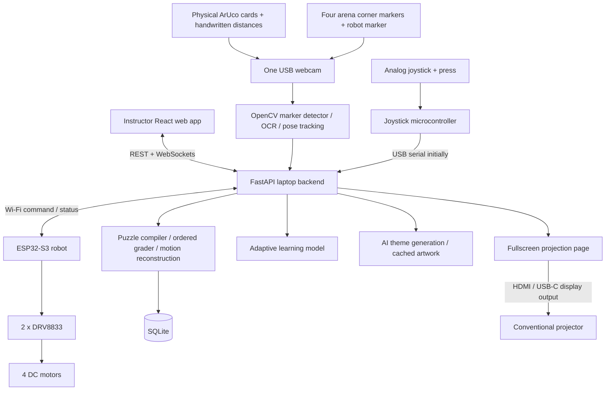

> **2026-11-15 card-format update:** Physical cards now use 2-inch ArUco DICT_4X4_1000 IDs 0/1/2/3 for FORWARD/BACKWARD/RIGHT/LEFT, with one cell per translation block and repeated blocks for longer movement. The handwritten-distance/OCR requirements below describe the superseded format. See [current unit-block contracts and printing](UNIT_BLOCKS.md).

# Grassroot — Unified Project Architecture & MVP Specification

**Project:** Grassroot (formerly CodeAnywhere)  
**Track:** Education; optional Physical AI / Practical AI  
**Timeframe:** 72-hour hackathon  
**Target learners:** Grades 2–4  
**Primary operator:** Parent/instructor  
**Status:** Consolidated implementation specification; hardware specifications and integrations identified as *unverified* below must be tested.  
**Core programming scope:** `START`, `FORWARD n`, `BACKWARD n`, `LEFT`, `RIGHT`, `STOP`. **No programming loops, conditionals, functions, sideways movement, or arbitrary-angle turns.** Normal software control flow (e.g., internal error handling) is not excluded.

> **Summary.** Grassroot teaches programming by letting children arrange physical ArUco-tagged coding cards with handwritten movement distances. A laptop webcam scans their code; a four-wheel ESP32-S3 robot executes it on a maze projected onto the floor. In reverse mode, a separate joystick lets children drive the robot continuously, then reconstructs a supported block sequence from the recorded actions and observed path. The instructor web app controls sessions, calibration, maze themes, levels, ordered-path scoring, progress analytics, and adaptive challenge recommendations. The robot does not talk to children or provide conversational instruction.

---

## 1. Confirmed decisions and governing principles

| Question | Final decision |
|---|---|
| Name | **Grassroot** everywhere in UI, code docs, project branding |
| Physical distance input | **Handwritten integer** written on `FORWARD` / `BACKWARD` cards; OCR + instructor confirmation |
| AI | **Generated visual maze themes** and **adaptive learning / challenge selection**; no chatbot |
| Grading | **Ordered, index-by-index comparison of observed cell entries to target entries** |
| Joystick | **Continuous driving** with push-button start/stop recording; conversion to discrete blocks is an estimate |
| Cameras | **One generic USB webcam**, shared between card scanning and arena tracking; phased capture or carefully designed shared view |
| Persistence | **SQLite**, locally hosted on the laptop |
| Projection | Conventional projector as a **passive laptop video display**; no projector control API |
| Robot | ESP32-S3 + 4WD mecanum-style chassis + two dual-channel motor drivers, subject to hardware verification |

**Non-negotiable behavior:** The instructor owns puzzle definition and run approval. The target path is a sequence, *not* merely a collection of allowed cells. An incorrect entry does not halt the program or poison later grading. Execution halts for explicit stop, board limits, communication/tracking faults, or other operational safety conditions. Keep correctness results distinct from hardware/vision faults. Generated themes cannot change puzzle geometry or correct answers. Adaptive AI must never autonomously authorize motor actions.

### 1.1 Three hardware subsystems + laptop

1. **Robot car:** 4WD mecanum chassis, four DC motors, ESP32-S3, two DRV8833 dual motor-driver modules, safe power supplies, optional top-mounted tracking marker.
2. **Separate joystick controller:** two-axis analog joystick with integrated press switch and **its own microcontroller**, preferably a second ESP32-S3, initially tethered to the laptop through USB.
3. **Camera/projector station:** one generic USB webcam plus a conventional projector, both connected to laptop, physical programming cards, printed calibration markers, projector surface and mounts.
4. **Laptop/software hub:** React web UI and fullscreen projection view, FastAPI backend, OpenCV + OCR, control/vision services, deterministic maze/grading engine, SQLite and optional image-generation/learning services.

### 1.2 High-level architecture



**Single source of truth:** the backend holds the active puzzle, immutable run/program snapshot, authoritative ordered visit index, device state, recording state and attempt history. The instructor page and projector page subscribe to the same state; neither determines correctness independently.

---

## 2. Learning objectives, game modes and coordinate conventions

Learning targets are **sequencing, movement parameters, left/right orientation, spatial reasoning, prediction, and debugging**. Grade 2–4 activities vary in route length, distance values, number of turns, and obstacle complexity, **not** loops/conditionals.

### 2.1 Forward coding — physical cards → robot

1. Instructor selects/creates puzzle (start cell, start heading, ordered target path, goal, grid size) and chooses theme/level.
2. Instructor calibrates camera-to-board and projector-to-board; projection displays the current maze.
3. Student lays cards in a **single horizontal ordered row** on a scan mat and writes integers on `FORWARD`/`BACKWARD` cards.
4. Instructor presses **Scan**. OpenCV identifies each card's marker and left-to-right order. OCR reads the numeric field for translation cards.
5. Instructor reviews an image crop, recognized command, candidate number and uncertainty for each card; **must correct/confirm any ambiguous value**. Invalid sequences cannot run.
6. Backend freezes the confirmed puzzle version, program, intended route and run ID. Instructor presses **Run**.
7. Backend validates board bounds, sends idempotent commands to robot, and tracks observed stable cell entries where camera tracking is available.
8. Each observed entry is graded against the **same-index target entry**. Overlay feedback is projected live; an incorrect entry does **not** itself stop the robot.
9. Robot stops after explicit `STOP`, normal program completion, boundary limit or operational fault. Instructor reviews results and resets for another attempt.

### 2.2 Reverse coding — joystick → generated physical program

1. Instructor selects a maze and **Reverse Coding** mode; system confirms robot start pose and drive readiness.
2. First **joystick push** starts recording. Student drives **continuously** with up/down/left/right; neutral stick stops movement. Ignore or resolve diagonals using a documented dominant-axis rule; use a center dead zone.
3. Controller sends timestamped analog/directional joystick samples. Laptop relays speed/turn commands to robot and records raw inputs plus command acknowledgments and available camera-derived positions/headings.
4. Second debounced push **stops motors immediately**, ends recording, and triggers route reconstruction.
5. Backend segments the movement into forward/backward translation and left/right 90° rotations, estimates full cells, compresses consecutive same-direction movement, and emits `START ... STOP` with integer steps.
6. App shows the generated cards and any **uncertain/unrepresentable** portions. Instructor may confirm/edit the result; child can rebuild it physically for replay.
7. Free recording has no invented target path; if the instructor loaded a target, recorded entries can also be evaluated against it.

**Important limitation:** Continuous driving may include curves, fractional-cell motion, variable turning angles, sliding, and wheel slip. Those motions cannot be represented exactly in the simple block language. Generate only a validated/quantized **approximation**, display a confidence/uncertainty flag, and retain raw trajectory. Never advertise perfect recreation. **Position alone cannot distinguish backward travel from forward travel or in-place turns; use joystick intent and robot heading.**

### 2.3 Canonical game coordinates and semantics

- Coordinates `{row, col}` are zero-indexed; row increases downward, column rightward in the instructor's unwarped canonical board.
- Continuous `{x, y}` is in **cell units**; cell center is `(col + 0.5, row + 0.5)`.
- Heading is N, E, S or W, with continuous angle retained for motion tracking. Suggested display convention: 0°=N, 90°=E.
- `FORWARD n` / `BACKWARD n` translate **n full cells** relative to current facing, with integers **1–5 by default**, configurable and confirmed. A multi-cell movement yields an observed entry **for each entered cell**.
- `LEFT` / `RIGHT` turn **90° in place**, not a cell entry. No lateral mecanum strafe commands in MVP.
- Exactly one `START` first and one `STOP` last. `START` is syntax, **not** an authorization to energize motors; instructor Run is required. `STOP` ends the program.
- Validate path bounds in software before run; keep physical edge margins and live boundary monitoring.

### 2.4 Puzzle definition and route vs artwork

The instructor supplies or edits a **structured puzzle**: grid rows/cols, start and initial heading, ordered expected cell entries (including revisits), goal and optionally scenery/obstacle cells. For the MVP, puzzle upload is **JSON or visual editor output**, not arbitrary image-to-route inference. Physical obstacles are not implied by projected images.

AI creates only decorative theme artwork. Even if the image contains a painted road, **the structured route remains authoritative**.

---

## 3. Ordered grading and projected feedback

### 3.1 Grading rule

Store `startCell` separately. `targetEntries` contains each expected cell **after leaving start**, including repetitions. `actualEntries` contains camera-confirmed stable transitions into cells; initial stationary start detection is not a visit.

For each newly observed stable cell entry at index `i`:

```text
expected = targetEntries[i] if i < length(targetEntries) else null
correct = expected != null AND actualEntries[i] == expected
append VisitEvent(index=i, actual, expected, correct, timestamp)
update that physical cell's visit history
increment i, regardless of correctness
```

Example:

| Entry index | Expected | Observed | Grade |
|---:|---|---|---|
| 0 | A | A | Green |
| 1 | B | C | Red |
| 2 | C | B | Red |
| 3 | D | D | Green |

**Do not wait for a child to 'recover' to the expected cell. Do not turn every later cell red after one mistake.** Extra entries beyond target length are red; unobserved expected entries remain incomplete. Repeated camera frames inside the same cell do not count as revisits. A new entry is recorded only after confirmed departure and return; apply temporal/spatial hysteresis to avoid boundary jitter.

A useful default success rule is exact ordered visits, no missing/extra visits, correct end cell and normal completion. Record `reachedGoal` separately from `pathExactlyCorrect`, so reaching the goal by a different route does not erase an error.

### 3.2 Cell revisit rendering

| Visitation history | Projected cell feedback |
|---|---|
| Never visited | Original maze/background |
| All correct | Solid green |
| All incorrect | Solid red |
| First wrong, next correct | Diagonal red-left / green-right split |
| First correct, next wrong | Diagonal green-left / red-right split |

Suggested split line: bottom-left to top-right, with a top-left-touching triangle labeled **left** and bottom-right-touching triangle labeled **right**. Include symbols/legend in addition to colors.

**Unsettled default for 3+ mixed visits:** preserve the **first** result on the left and **latest** on the right; show solid when those match. Always preserve the complete event history in SQLite. This rule is a **proposed implementation default**, not user-confirmed.

### 3.3 Tracking uncertainty and failure separation

Do **not** invent cell visits when camera tracking loses the robot, misses transitions, or jumps multiple cells in one frame. Record `TRACKING_UNCERTAIN` and pause/stop if needed. Keep separate categories for learner coding error, actuator drift, tracking failure, communication failure and safety stop. Motor command acknowledgment is **not** proof of physical location.

---

## 4. Hardware A — ESP32-S3 four-motor car

### 4.1 Parts / verified status

| Component | Qty | Requirement / verification |
|---|---:|---|
| Hiwonder 4WD mecanum-style chassis | 1 | **Exact SKU unverified**; confirm kit contains 4 DC motors, 4 correct-handed mecanum wheels, plates, mounting screws |
| ESP32-S3 development board | 1 | **Exact model unverified**; confirm pin access, USB programming, supported input power |
| Adafruit DRV8833 dual DC motor driver | 2 | Each handles 2 DC motors; confirm exact purchased board, connectors, thermal/current characteristics |
| Four motors | 4 | **Motor voltage, nominal/stall current, gear ratio and encoder presence unverified** |
| Motor battery pack, holder and appropriate cells | 1 | Choose only after verifying motor voltage and aggregate startup current; prior 4×AA alkaline concept is provisional |
| USB power bank or appropriate regulated 5V input | 1 | Powers ESP32-S3 by supported board input; separate from motor pack initially |
| Motor wiring / secure terminal connectors | Set | Size for motor current; do not route motor supply through solderless breadboard rails |
| Low-current jumpers, mounting protoboard | Set | Driver control logic and stable mounting |
| Accessible motor power switch | 1 | Immediate hardware shutoff; optional inline fuse matched to pack |
| Bulk/decoupling capacitors near drivers | As rated | Use board/vendor guidance and adequate voltage rating |
| Standoffs / zip ties / Velcro / 3D printed bracket | Set | Keep all wiring clear of wheels |
| Printed upward-facing unique ArUco tracking marker | 1 | Needed for camera-based pose tracking; marker-to-robot center/height calibrated |
| Screwdrivers, wire cutters, multimeter, soldering supplies | Set | **Soldering may be necessary** for driver/ESP32 headers |

### 4.2 Electrical connection diagram

```text
LAPTOP / FASTAPI  <-- local Wi-Fi -->  ROBOT ESP32-S3 (USB power bank)
                                          | 8 direction/PWM GPIO signals
                  +-----------------------+------------------------+
                  |                                                |
             DRV8833 #1                                      DRV8833 #2
             AIN1/AIN2 --> Front Left                        AIN1/AIN2 --> Front Right
             BIN1/BIN2 --> Rear Left                         BIN1/BIN2 --> Rear Right
             AOUT/BOUT --> respective motors                 AOUT/BOUT --> respective motors
             VM ----+                                        VM ----+
             GND ---|------------------------------------------ GND -|-- shared motor GND
                    +------------------ MOTOR PACK -----------------+

ESP32-S3 GND ---------- common ground with both DRV8833 boards and motor battery negative
Motor battery positive --> driver VM rails (through suitable switch/protection)
ESP32 power --> supported USB / regulated board input, never direct motor voltage on 3.3V pin
```

**Provisional GPIO map — only an example, NOT confirmed for your exact ESP32-S3 board:**

| Robot GPIO | Connection |
|---|---|
| 4, 5 | Driver #1 AIN1, AIN2 (front left) |
| 6, 7 | Driver #1 BIN1, BIN2 (rear left) |
| 8, 9 | Driver #2 AIN1, AIN2 (front right) |
| 10, 11 | Driver #2 BIN1, BIN2 (rear right) |
| 12 | Both driver `SLP`/sleep enable (subject to specific breakout labeling) |
| GND | Both DRV8833 GND; common with motor pack negative |

On each driver connect `AOUT1/AOUT2` to its A motor and `BOUT1/BOUT2` to its B motor. Connect `VM` and GND to proper motor battery supply. The ESP32-S3's 3.3V logic output should be compatible with the selected driver logic input; verify board documentation. Check actual ESP32-S3 exposed/reserved/strapping pins before using the provisional map.

**Driver and power cautions:** DRV8833 supports a finite motor-voltage and per-channel current envelope; do not assume every 4WD motor is safe at its stall current. Adafruit's standard breakout has approximately **1 A/channel default current limiting**; confirm the installed version and thermal behavior. The motor battery pack must handle the **combined** load of four starting motors. A separate USB power source for the ESP32 can simplify noise/debugging; always share logic ground. Don't attach motors to GPIO, don't feed motor supply to the board's 3.3V rail, and avoid breadboard power rails for motor currents.

### 4.3 Drive calibration and mapping

- Mechanically verify all four mecanum wheels' roller orientations; calibrate polarity **one wheel at a time**.
- Set speed limits and PWM per motor; left/right 90° turns are approximate until closed-loop tracking is reliable.
- Measure the actual physical width of one projected cell. Calibrate motor durations for **one-cell translation** and **90° rotation** on the actual floor/voltage conditions.
- A plain TT-motor chassis without encoders cannot guarantee distance. Optional overhead pose feedback can correct/stop drift; wheel slip and marker tracking uncertainty remain.
- Disable sideways strafing for MVP even though mecanum wheels may support it.

### 4.4 Robot firmware requirements

- Boot motors **off** and connect to local Wi-Fi.
- Receive bounded commands and short joystick drive updates; acknowledge by `runId`, `commandId`, sequence and status.
- Map controlled motor directions/PWM to forward/back/left/right; accept STOP independently of normal queue.
- Use heartbeat/command timeout, maximum PWM, movement time limit, command queue limit and power-off/operational stop.
- Do not re-execute a repeated command with the same unique ID; retries must be idempotent.
- Stop on malformed messages, loss of control lease, heartbeat timeout, safety fault or explicit emergency stop.
- Publish telemetry and fault state. Completed motor command ≠ observed physical completion.
- Permit **exactly one** active control owner (forward program **or** joystick), never both.

---

## 5. Hardware B — independent continuous joystick

| Component | Qty | Notes |
|---|---:|---|
| Two-axis analog joystick with integrated press switch | 1 | Analog X/Y + digital button |
| Separate ESP32-S3 or ADC-capable microcontroller | 1 | **Exact board unverified**; USB serial is preferred for MVP |
| USB data/power cable | 1 | Computer connection; wireless + battery is stretch |
| Breadboard/headers/wires and enclosure | Set | Secure analog connections and switch |
| Optional 3D-printed joystick box | 1 | Mechanical engineers / 3D printer can help |

**Provisional wiring** (verify joystick module voltage and actual joystick ESP32-S3 pinout):

| Joystick | Microcontroller |
|---|---|
| VCC | 3.3V **only if the module supports it** |
| GND | GND |
| VRx | GPIO 1 ADC |
| VRy | GPIO 2 ADC |
| SW | GPIO 4 with input pull-up |

**Input processing:** sample continuously, calibrate resting center, use a dead zone, constrain to dominant X/Y direction (ignore diagonals in the initial UI), and debounce button. When button transitions to recording, obtain the control lease; second press ends recording and **sends STOP** immediately. Neutral stick also commands motor STOP. Send timestamped raw X/Y/button samples plus normalized intent to laptop over serial; backend relays safe bounded motion requests to ESP32-S3. USB joystick power does not power motors.

**Continuous-to-code reconstruction:** preserve raw samples, intended direction, heading, timestamps, camera pose samples, command acknowledgments, and resulting segment list. Segment into translation/rotation based on heading and joystick input; quantize against calibrated cell dimensions/90° headings; compress adjacent same-direction segments into integer-cell commands. Show uncertainty when paths curve, cross fractional cells, rotate partially or are not seen by camera. Never silently convert impossible segments into an exact claim.

---

## 6. Hardware C — one camera, physical cards, passive projector

### 6.1 Inventory and physical layout

| Part | Qty | Purpose |
|---|---:|---|
| USB generic webcam, preferably 1080p | **1** | Card + handwritten field scanning; arena/robot pose tracking during separate phase or fixed shared view |
| Laptop capable of Python OpenCV and video output | 1 | Central computer vision/backend/UI host |
| Conventional projector | 1 | Laptop HDMI / USB-C display output; **no projector API** |
| Stable camera mount / overhead arm | 1 | Repeatable scan and tracking geometry |
| Projector mount | 1 | Prevent alignment drift |
| Flat light-colored floor mat/sandbox | 1 | Legible projected grid; physical robot clearance |
| Four unique corner ArUco markers | 4 | Board TL/TR/BR/BL anchors |
| Robot top marker | 1 | Live robot pose if arena tracking is active |
| Coding cards / scan mat | Set | One row, distinct IDs per physical card, visible opcode, handwriting box |
| Printed calibration test pattern | 1 | Instructor-adjusted projector warp |
| Cardboard/lamination/3D-print card holders | As useful | Robust scanning; physical classroom handling |
| Extra lighting | As needed | Stable marker/OCR image quality, avoid washing out projection |

**Camera limitation:** A single webcam often cannot simultaneously read **small handwritten numbers on nearby cards** and track a robot across a large floor arena at usable resolution. Design for **two phases with one camera**: (a) fixed close card scan while robot is stopped; (b) move/rotate the camera to an arena view and **recalibrate** before execution; or choose a carefully tested wide fixed view. A shared view is allowed only if actual tests demonstrate both tasks work. No claim of uninterrupted live camera tracking during scanning. Use hardware mounting marks to make repositioning repeatable.

### 6.2 Cards and OCR (handwriting is confirmed)

**Exactly supported cards:** `START`, `FORWARD`, `BACKWARD`, `LEFT`, `RIGHT`, `STOP`. `FORWARD` and `BACKWARD` each have a dedicated **blank handwritten integer step-count box**. Numbers are **not separate physical code tiles** in the final design.

- Each individual physical card has a **distinct ArUco marker ID**, including duplicates of the same command. Map each ID to an opcode.
- Lay cards in a single ordered horizontal row on a marked scan mat. Sort by rectified marker centers along row; reject unclear layouts or missing IDs.
- Rectify a detected card using its marker/card corners, crop its dedicated number box, and perform OCR **only** on translation cards.
- Return recognized digit candidate, confidence/ambiguity, crop, card ID, and order. Store raw recognition separately from instructor-confirmed program.
- Numeric constraints: integer from 1–5 initially (configurable). Reject blank, negative, decimal, oversized or unconfirmed numbers.
- Instructor has a mandatory **Scan → Review → Confirm → Run** workflow. Do not silently guess a number; provide explicit correction UI and preview.
- **Fallback**, if OCR fails: instructor manually types the handwritten number in scan-review form; retain the physically handwritten card as the interaction. Do not quietly change to separate number tiles.
- Detect/lock commands on deliberate **Scan** action, not constantly overwrite an active program while cards move.
- OpenCV ArUco marker recognition is conventional CV, not itself a trained AI model. OCR can be a conventional or learned recognizer; quality must be tested against real handwriting.

### 6.3 Camera-to-grid calibration

1. Place four uniquely identified physical markers at known board corner positions: **TL, TR, BR, BL**. Maintain a flat, fixed mat/plane.
2. Detect markers and calculate a homography from image pixels to **canonical grid coordinates**.
3. Place a distinct robot marker on top, calibrate its offset from robot center and its orientation to vehicle forward.
4. **Robot height matters:** floor-plane homography applied directly to an elevated roof marker causes parallax error; compensate for marker elevation or measure a validated correction/limit.
5. Smooth pose and use cell-transition hysteresis; log stale/uncertain pose if marker becomes occluded.
6. If the camera moves between scan and arena positions, invalidate/re-run camera calibration; do not reuse a stale homography.

### 6.4 Projector calibration and rendering

The projector is a **passive display**, driven by a fullscreen browser `/projection` page sent over the laptop's normal display connection. No vendor SDK, API, or projector firmware control. Prefer **extended desktop**: instructor UI on laptop and clean fullscreen `/projection` on projector. A fullscreen single-display fallback is acceptable; naïve mirroring of the entire instructor desktop is not a clean projection layout.

1. Project a test board. Instructor identifies/adjusts its four output corners using draggable handles plus fine nudge controls.
2. Keep camera-to-grid mapping and projector-to-grid mapping **independent**, though both share canonical board coordinates.
3. Warp **the entire board composition** (background + exact grid + start/goal + colored feedback + symbols) via a four-corner projective transform/homography, not just scaling/cropping.
4. Store calibration normalized to projector viewport geometry; warn/recalibrate on resolution, aspect, projector position or board changes.
5. Preserve clear regions for physical markers so projected artwork does not obscure detection. Strong contrast, flat light surfaces and proper focus matter.
6. Calibration cannot fix optical blur, moving equipment, floor unevenness or an occluded beam.

### 6.5 Robot tracking and live scoring

During execution, overhead arena view yields time-stamped marker pose. Convert position to canonical cell, apply hysteresis for stable entries, emit entry events once and score ordered entries centrally in backend. If arena view is unavailable, **simulate** these events for software demo or explicitly label movement as **uncorroborated open-loop**, not camera-confirmed live grading. Continuous joystick reverse coding likewise needs observed heading/path for credible reproduction.

---

## 7. Web application and software modules

### 7.1 Pages

| Page | Responsibilities |
|---|---|
| Dashboard | Student/session list, connection status, progress snapshot |
| Setup & calibration | Camera scan/arena modes, physical corner detection, projector four-point alignment, robot drive calibration |
| Puzzle editor | Grid dimensions, start cell/heading, ordered target entries, goal, obstacles/scenery; structured JSON import/export |
| Theme panel | Select cached/standard theme, generate AI theme, preview, accept/retry/fallback |
| Programming / scan review | Card image, parsed ordered instructions, handwriting crops, manual corrections, confirm/freeze program |
| Live attempt | Run, Stop, robot pose, ordered entry index, faults, per-cell grade, attempt review |
| Joystick / generated code | Recording status, raw path visualization, generated blocks and uncertainty, optional replay |
| Projection (`/projection`) | Only fullscreen maze/artwork/grid/start/goal/live feedback; no controls |
| Student progress / learning analytics | Completion, attempts, direction/distance/sequencing errors, learning-skill estimates, next-maze recommendations |

### 7.2 Technology

| Layer | Proposed stack | Notes |
|---|---|---|
| Frontend | React + TypeScript + Vite | Shared canonical board renderer used for instructor preview/projection |
| Backend | Python + FastAPI | Single authoritative game/control state; REST + WebSocket events |
| Computer vision | OpenCV + ArUco | Marker ID detection, orientation, camera mapping, robot pose |
| OCR adapter | Replaceable handwriting digit recognizer | Only card numeric boxes; instructor confirmation mandatory |
| Projection | HTML Canvas/SVG/WebGL and projective warp | Conventional video output; no hardware-specific API |
| Maze / grading | Pure Python deterministic modules | No AI dependency in safety/grading |
| Adaptive learning | Bayesian Knowledge Tracing (BKT) or other small explicit probabilistic estimator | Skill modeling initially from limited/simulated history; transparent uncertainty |
| Maze challenge selector | Valid structured maze generator/validator plus skill-informed selection | Instructor final approval; deterministic geometry |
| AI image themes | Replaceable image-generation provider adapter | Server-side credentials, cached approved decorative backgrounds |
| Database | SQLite | Puzzles, students (minimal identifiers), attempts, visits, pose summaries, calibration, assets |
| Robot firmware | Arduino framework C++ on ESP32-S3 | Motor PWM, wireless transport, acknowledgments, watchdog |
| Joystick firmware | Arduino framework C++ on separate microcontroller | ADC/button to timestamped serial data |

### 7.3 Suggested repo layout

```text
grassroot/
├── frontend/
│   └── src/
│       ├── pages/{Dashboard,Setup,PuzzleEditor,Session,Progress}.tsx
│       ├── components/{MazeBoard,CodeCards,RobotStatus,ScanReview}.tsx
│       ├── projection/ProjectionView.tsx
│       ├── calibration/{CameraCalibration,ProjectionWarp}.tsx
│       └── api/{client,events}.ts
├── backend/
│   └── app/
│       ├── main.py
│       ├── models/{puzzle,commands,events,student}.py
│       ├── session/{state,controller}.py
│       ├── grading/{ordered_grader,visit_history}.py
│       ├── compiler/{card_parser,route_validator}.py
│       ├── vision/{camera_adapter,aruco,ocr,pose,calibration}.py
│       ├── robot/{transport,command_queue}.py
│       ├── recording/{joystick_adapter,trajectory_to_code}.py
│       ├── ai/{theme_service,learning_model,maze_selector}.py
│       ├── storage/{sqlite_db,models,migrations}.py
│       └── api/{puzzles,runs,scan,recording,theme,students}.py
├── firmware/
│   ├── robot_esp32s3/robot_esp32s3.ino
│   └── joystick_controller/joystick_controller.ino
├── assets/{aruco_cards,calibration,theme_fallbacks}/
├── fixtures/{puzzles,scans,pose_streams,joystick_recordings}/
├── tests/
└── docs/
```

### 7.4 Instructor control states

Exclusive run states: `IDLE`, `SCANNING`, `PROGRAM_READY`, `RUNNING`, `RECORDING`, `COMPLETED`, `STOPPED`, `FAULT`. Calibration only while motors are stopped. Changes to puzzle, theme, cards or calibration must not mutate an active run. Program execution and joystick driving are **mutually exclusive**. A new run requires confirmed starting location and heading.

### 7.5 Core data contracts (illustrative TypeScript)

```typescript
type Cell = { row: number; col: number };
type Heading = 'N' | 'E' | 'S' | 'W';
type Instruction =
  | { op: 'START' | 'STOP' | 'LEFT' | 'RIGHT'; cardId?: number }
  | { op: 'FORWARD' | 'BACKWARD'; steps: number; cardId?: number };
type Puzzle = {
  id: string; version: number; name: string;
  rows: number; cols: number;
  startCell: Cell; startHeading: Heading; goalCell: Cell;
  targetEntries: Cell[];
  blockedCells?: Cell[];
};
type RobotPose = {
  timestampMs: number; x: number; y: number;
  headingDeg: number; trackingValid: boolean;
};
type VisitEvent = {
  attemptId: string; index: number; timestampMs: number;
  actual: Cell; expected: Cell | null; correct: boolean;
};
type RobotCommand = {
  commandId: string; runId: string; instructionIndex: number;
  op: 'FORWARD' | 'BACKWARD' | 'LEFT' | 'RIGHT' | 'STOP';
  steps?: number; maxDurationMs: number; speed: number;
};
```

All contracts are validated server-side. Every robot message includes IDs and an execution status; duplicate/retried messages must not cause duplicate movement. Distinguish commanded motion, motor acknowledgments and camera-observed motion.

### 7.6 API and event surface

- REST: puzzle CRUD/import/export; camera/projector calibration save/load; scan request; review & confirm program; start run; **emergency/operational Stop**; reset attempt; start/stop joystick recording; generated-program retrieval; student progress; theme generation/preview/accept/fallback.
- WebSocket: snapshot on reconnect plus numbered ordered updates for pose, cell entered, entry grade, execution state, record state, calibration warning, fault, theme generation status. Handle event sequence numbers so reconnect never duplicates graded visits.
- Robot transport: choose **one** stable local Wi-Fi mechanism (e.g., HTTP command requests with idempotency or WebSocket); keep behind an adapter. Joystick USB serial similarly behind an adapter.
- **Persistence:** SQLite migrations for `students`, `puzzles`, `attempts`, `visit_events`, `command_events`, `recordings`, `calibrations`, `theme_assets`, `skill_estimates`. Keep schema minimal, retain timestamps and puzzle version.

---

## 8. AI features — no conversational child-facing assistant

### 8.1 AI-generated decorative themes (selected)

Instructor/child selects a theme (e.g., space, underwater, dinosaurs, firefighter). Backend builds a **single** request with fixed rows, columns, route, start/goal, heading, cell roles, reserved marker regions and reference layout. Request an age-appropriate **flat top-down** image with consistent style and no text, misleading routes or grade-colored imagery.

**Hard boundary:** Generated artwork is *decorative*. An image model cannot guarantee exact geometry by prompting. The app renders the authoritative grid, valid route cues, starts/goals, and live feedback **deterministically on top**. Maze dimensions, `targetEntries`, grading, robot commands and calibrations must remain unchanged across themes. Preview/accept is instructor-controlled.

Pipeline:

1. Freeze puzzle version/hash and serialize fixed layout constraints.
2. Generate a reference board image showing exact cell roles/edges/start/goal/marker reserved zones.
3. Send one coherent theme image request through server-side provider adapter (not an agent workflow).
4. Validate response size/decoding/associated puzzle hash and align to canonical board aspect ratio.
5. Show instructor preview with exact overlays. Accept, regenerate or use prepared fallback.
6. Cache accepted local image with puzzle hash, theme/style, output settings and prompt version; project only when not RUNNING/RECORDING.
7. If generation fails/times out, continue using an existing local theme. Never block Stop or movement safety.

Rendering order back to front: **approved themed background → exact app-generated grid/routes → start/goal and text/symbols → green/red/split live grading overlay**. Warp final composition to projector quadrilateral. Keep corner markers and tracking marker visually unobstructed. API credentials server-side; exclude student-identifying information from generation prompts.

Suggested theme metadata: `requestId`, `puzzleId`, `puzzleVersion`, `puzzleHash`, `themeText`, rows/cols, start/heading/goal, ordered entries, layout reference, reserved regions, dimensions, provider/model, image path, status, accepted timestamp. Use separate `IDLE/GENERATING/READY/FAILED` lifecycle from robot session states and ignore stale results after puzzle edits.

### 8.2 Adaptive learning and challenge selection (selected)

**Goal:** Adapt the *next* instructor-approved maze based on performance in **sequencing, direction, distance, and spatial reasoning**. Keep grading purely deterministic.

- Collect per-attempt features: expected/observed ordered entries, completion, attempts, command counts, distance-entry corrections, direction-related errors (only when attributable), pace and level.
- Estimate skill mastery with a simple, transparent probabilistic model, e.g., **Bayesian Knowledge Tracing** (BKT). Set initial probabilities explicitly; update from observed student responses with uncertainty. A hand-authored rules baseline is allowed until enough data exist.
- Create a **pool of solvable structured mazes** algorithmically; score candidates based on desired turn count, movement lengths, route complexity, and the current skill profile.
- Recommend one or more next puzzles targeting a weaker skill; **instructor selects/approves** the challenge and can override AI suggestions.
- Display trend charts and explanatory summaries on instructor dashboard. Do **not** portray scores as validated diagnoses, objective intelligence measures or proven learning gains.
- **Dataset reality:** at hackathon start, no real longitudinal learner dataset is assumed. Use clearly labeled **simulated student histories** to demo personalization; never describe synthetic evaluation as real classroom results.
- **Scope:** no chatbot, autonomous teaching agent, learning-model control over motors, hidden personalization that changes target correctness, or unapproved changes mid-run.

**Example:** Student A has strong turn accuracy but repeatedly misreads written distances → next recommended maze emphasizes 2–4-cell translations. Student B struggles with direction changes → recommend a shorter maze with several 90° rotations. Neither recommendation requires loops or conditionals.

---

## 9. Safety, reliability and calibration gates

### 9.1 Execution and operational stop rules

- Robot moves only after explicit instructor Run or active, confirmed joystick recording session.
- Real motor power-off switch accessible to adult; software Stop always available.
- On command start, check target instruction sequence and projected arena bounds. **Reject a planned out-of-bounds move**, rather than wrapping/clipping it.
- During run, monitor safe speed, maximum duration, local physical clearance, tracking freshness/quality, confirmed stop conditions and heartbeat.
- When a wrong target cell is visited but physical movement remains safe, **continue and grade**; do not stop because of learner error.
- On likely physical boundary exit, lost heartbeat, stale required pose, fault, or instructor stop, stop motors and record distinct reason.
- One active control lease prevents simultaneous joystick and code execution.
- For moving robot tests, use flat open surface, low speeds, supervised adult control, protected power connections and clear physical boundaries; projected obstacles are *not* barriers.

### 9.2 Unverified assumptions to resolve before final wiring

| Issue | Status / action |
|---|---|
| Exact Hiwonder chassis model and included motors | **Unverified**; inspect box contents and motor labels |
| Motors' operating voltage / stall current | **Unverified**; confirm compatibility with DRV8833 current limits and motor supply |
| ESP32-S3 exact development board and GPIO availability | **Unverified**; provisional map only, check reserved pins |
| DRV8833 board type, soldered headers, current/thermal capacity | **Unverified**; physical inspection and datasheet |
| Battery chemistry, pack discharge and voltage regulation | **Unverified**; design for four simultaneous motor starts and separate controller power |
| One-camera resolution across scan and arena | **Unverified**; plan phased reposition/calibration or verified shared view |
| Handwritten-digit OCR accuracy | **Unverified**; sample real written cards, always retain manual review fallback |
| Projector floor size/brightness/warp | **Unverified**; test on site and record four-corner calibration |
| Robot marker elevation/parallax correction | **Unverified**; measure and validate location accuracy |
| Continuous joystick route quantization quality | **Unverified**; flag approximate/nonrepresentable sections |
| Boundary margin / watchdog timeouts / filtering thresholds | **Implementation parameters**; test and record rather than invent fixed safe values |
| Three-plus-revisit display reducer | **Proposed default:** first vs latest; not yet separately confirmed |

---

## 10. Implementation order for 72 hours

| Phase | Milestones | Demonstration gate |
|---|---|---|
| **Day 1** | Shared contracts, sample structured puzzle, simulator, pure ordered grader, tile history renderer, React board/projection, ESP32-S3 and individual motor tests, joystick readings | Simulated ordered scoring works; robot responds to safe minimal command |
| **Day 2** | Card ArUco detection + handwritten number crops/OCR/manual confirmation, projection four-corner editor, camera arena calibration, robot motor transport/watchdog, joystick continuous recording, normalized output | Physical cards → confirmed commands → physical robot; record joystick and view raw/generated actions |
| **Day 3** | Integrate live robot tracking, stable cell entries, ordered color feedback/revisits, basic student records in SQLite, adaptive skill profile, themed image preview/caching, rehearsal and fallback testing | Full instructor-led demo with both modes; faults and limits clearly visible |

**Parallel workstreams:**
- Hardware/mechanical: chassis and current-safe wiring, card + joystick enclosures, camera/projector mounts, sandbox.
- Embedded: motor drivers, ESP32-S3 networking/command IDs, joystick ADC/button serial, Stop/watchdog.
- Vision/geometry: card ID/OCR recognition; arena homography and tracked marker events; four-point projector renderer.
- Frontend/backend: contracts, simulator, deterministic grader, session states, SQLite, dashboard.
- AI: themes after deterministic board renderer; skill estimate/demo histories after attempt tracking.

**Scope priority:** (1) safe robot drive + printed cards/handwritten review + projected maze, (2) joystick recording + approximate generated code, (3) live camera-confirmed path grading + revisit feedback, (4) AI themes + adaptive learning. **Do not postpone hardware integration to the last day.**

### 10.1 Simulator and fallbacks

- Backend simulator accepts the same commands and emits synthetic poses/visits for repeatable grading tests; label simulator results visibly.
- If handwriting OCR is unreliable, have instructor correct the extracted number; cards stay handwritten.
- If one webcam cannot track arena and cards simultaneously, **scan then reposition and recalibrate**; don't claim simultaneous performance.
- If camera tracking fails mid-run, operationally stop/pause and mark unknown visits; avoid falsely marking cells.
- If AI theme provider fails, use prepared cached static artwork.
- If AI learning model has insufficient actual data, use labeled simulated histories or deterministic next-maze recommendation baseline.
- If continuous joystick drive cannot reconstruct a valid discrete route, show partial/inexact code with confidence notes and preserve raw recording.

---

## 11. Validation / acceptance tests

### 11.1 Functional acceptance

- [ ] Instructor creates/imports structured puzzle with grid, start pose, goal, ordered target entries.
- [ ] Board's four physical markers map camera positions to canonical cells; camera reposition invalidates mapping.
- [ ] Projected board aligns with instructor-adjusted quadrilateral; settings persist across app refresh unless display geometry changes.
- [ ] Instructor scan recognizes all valid individual ArUco cards in correct order; handwritten number crop/recognition is shown for review.
- [ ] Unreadable, invalid or unconfirmed numeric fields **cannot** silently execute; manual corrections are logged.
- [ ] Program freezes after Confirm/Run; moving cards afterward cannot modify the active command sequence.
- [ ] Robot follows accepted safe commands, prevents duplicate command execution and stops on watchdog/Stop/limit.
- [ ] Wrong path entry does not stop run; grade each stable entry by index independently.
- [ ] Target `[A,B,C,D]` vs actual `[A,C,B,D]` gives `[green,red,red,green]`.
- [ ] Multi-cell forward/backward enters one event for each observed traversed cell; initial starting cell and stationary frames are not counted.
- [ ] Extra observed entries show red, missing target entries show incomplete, tracking gaps do not fabricate entries.
- [ ] Revisits show proper solid/split presentation for first two entries; history retained for all visits.
- [ ] Instructor page and fullscreen projection remain synchronized; reconnect does not double-apply visits.
- [ ] Joystick button starts/ends recording with debounce; end immediately stops motors.
- [ ] Continuous joystick recording preserves raw samples and reports approximate generated blocks; backwards and turns are correctly represented when evidence supports them.
- [ ] Generated three-cell forward segment compresses to `FORWARD 3`, within validation range.
- [ ] Projected theme changes are previewed/accepted; cannot change puzzle route, scoring or calibration.
- [ ] Adaptive recommendations depend on performance features and remain instructor-approved; simulated data is clearly identified.
- [ ] SQLite persists attempts, entries, calibrations, themes and student progress as appropriate.

### 11.2 Unit/integration tests

- Parser: missing START/STOP, unsupported opcode, unordered scan, negative/non-integer/out-of-range handwritten distance, duplicate/missing marker, unconfirmed OCR.
- Route validator: turn-only commands, 1–5 translations, boundaries, blocked-cell policy, repeated cells.
- Ordered grader: exact match, swap, extra/missing entries, wrong then correct, revisit, stale tracking, skipped transitions.
- Event reducer: split color first/second, mixed 3+ visits proposed rule, reset, replay, reconnect event ordering.
- Transport: duplicate command ID, slow ack, lost heartbeat, emergency Stop, conflicting control requests.
- Joystick: centered dead zone, diagonal normalization, button bounce, continuous segments, fractional-cell ambiguity, release-to-stop.
- Calibration: four marker identity, perspective warp, changed resolution, moved camera, marker height effects.
- AI: theme puzzle-hash guard/caching/fallback and inference cannot change deterministic grades; recommendations do not mutate active puzzle.

**Never mark a physical test passed unless actually completed on the final hardware and surface.**

---

## 12. Demo script and success criteria

1. **Introduction:** “Kids learn to code with physical cards and a real robot; Grassroot turns programming into a projected interactive maze.”
2. Instructor selects level/maze; approved AI theme appears behind the authoritative grid and target route.
3. Student lays `START → FORWARD [handwritten 2] → RIGHT → FORWARD [handwritten 1] → STOP` cards. Webcam scans, instructor confirms OCR values.
4. Robot executes while projection displays green/red observed entries; show a deliberately wrong middle step that does not halt the run, and a later correct step.
5. Switch to reverse mode. Push joystick to record, steer a short controlled route, push again to stop; app generates an approximate sequence of physical cards from observed/commanded movement.
6. Open progress dashboard: show attempt history and a **clearly labeled simulated** student whose weak skill changes the next recommended maze.
7. Explain safety: deterministic grading and motor control are independent of theme/learning AI; adult remains in charge.

**Definition of success:** At least one real end-to-end hardware interaction in each coding mode, projector output, instructor confirmation and reliable stop handling. Any unverified tracking/AI feature is clearly labeled as prototype, simulated, or stretch rather than shown as operational when it is not.

---

## 13. Explicitly excluded functionality

- Programming loops, programming conditionals, functions, nested blocks, sideways/mecanum strafe instructions or arbitrary-angle turns.
- Robot voice, conversational tutoring, agent-driven pedagogy or automatic motor decisions from generative AI.
- Separate numeric cards as the selected primary distance input (handwriting is authoritative; manual instructor correction is fallback).
- Multiple simultaneous cameras (one webcam only for current MVP).
- Projector vendor API/device programming; projector image as sole source of puzzle route/answer.
- Cloud student-account system, unvalidated claims of learning gains, unsupervised operation, guaranteed exact joystick replay, auto-grading from motor commands when tracking is unavailable.

## 14. Handoff instructions for implementation team

Start with shared schema, deterministic ordered-grader tests, simulated robot/pose stream, central session controller and projection renderer. Wire actual motor + Stop circuit and command IDs early. Build webcam scan/OCR and arena view behind a **one-camera phase adapter**. Introduce two generative components only after the deterministic core is working: decorative **AI theme image service**, then an instructor-controlled **skill estimate / adaptive challenge selector**. Keep calibrated values, device models and unresolved defaults explicit and configurable. The result should run locally from a laptop, with all hardware, UI and projected view attached to the same live backend state.
